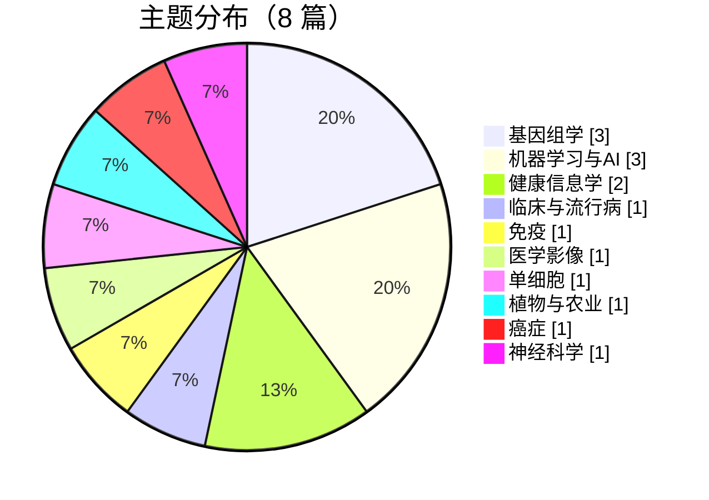
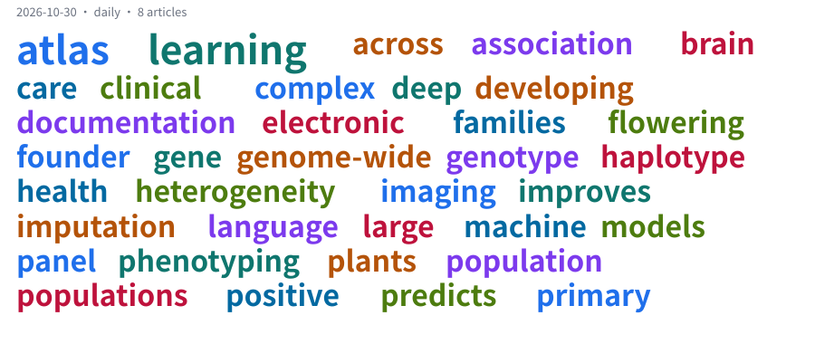

# 文献雷达 2026-10-30

> 扫描时间：2026-11-02 18:17（Asia/Shanghai）
> 严格时间窗：day → 2026-10-30（含两端）
> 本期刊：Nature Genetics、Nature Communications、JAMIA、bioRxiv
> 研究方向：分子进化；群体基因组学；基因家族扩张
> 收录范围：窗口内、官网可见、且此前未报告过的**全部**文章；相关性只决定置顶，不决定取舍
> 预印本（bioRxiv / medRxiv）单列在「预印本」一节，未经同行评审
> 置顶依据：keyword（关键词兜底）

## 与你最相关（2 篇）

### 1. Positive selection on gene families in flowering plants
- 期刊：bioRxiv
- 出版商状态：Preprints
- 预印本：是（未经同行评审，结论需自行核实）
- 预印本发布日期：2026-10-30
- 首次观察时间：2026-11-02 18:17
- DOI: https://doi.org/10.1101/2026.10.30.000001
- 作者：未提供
- 相关性：0.78 —— 关键词命中：positive selection、gene family expansion
- 主题：positive selection · gene family expansion
- 英文摘要：We scan genomes for positive selection and gene family expansion across flowering plants.
- 可见性来源：https://doi.org/10.1101/2026.10.30.000001
- 摘要来源：https://doi.org/10.1101/2026.10.30.000001

### 2. Genome-wide association study of complex traits in a founder population
- 期刊：Nature Genetics
- 出版商状态：Latest Research
- 官网首次在线日期：2026-10-30
- 首次观察时间：2026-11-02 18:17
- DOI: https://doi.org/10.1038/s41588-026-02824-3
- 作者：未提供
- 相关性：0.70 —— 关键词命中：genome-wide association
- 主题：genome-wide association
- 英文摘要：A genome-wide association study identifies loci for complex traits in a founder population using whole-genome sequencing.
- 可见性来源：https://doi.org/10.1038/s41588-026-02824-3
- 摘要来源：https://doi.org/10.1038/s41588-026-02824-3

## 今日主题分布（8 篇）

| 主题 | 篇数 |
|---|---|
| 基因组学 | 3 |
| 机器学习与AI | 3 |
| 健康信息学 | 2 |
| 临床与流行病 | 1 |
| 免疫 | 1 |
| 医学影像 | 1 |
| 单细胞 | 1 |
| 植物与农业 | 1 |
| 癌症 | 1 |
| 神经科学 | 1 |

> 标签按标题/摘要关键词命中，一篇可命中多个，所以合计大于篇数。

## 期刊（5 篇）

### Nature Genetics（2 篇）

#### A haplotype reference panel improves genotype imputation across populations
2026-10-30 · Latest Research · 标签：基因组学 · [原文](https://doi.org/10.1038/s41588-026-02819-0) · [DOI](https://doi.org/10.1038/s41588-026-02819-0)

We constructed a haplotype reference panel from 490,319 genomes and benchmarked imputation accuracy across populations and variants.

#### Genome-wide association study of complex traits in a founder population
2026-10-30 · Latest Research · 标签：基因组学 · [原文](https://doi.org/10.1038/s41588-026-02824-3) · [DOI](https://doi.org/10.1038/s41588-026-02824-3)

A genome-wide association study identifies loci for complex traits in a founder population using whole-genome sequencing.

> 相关：关键词命中：genome-wide association

#### Nature Communications（2 篇）

##### Single-cell atlas of the developing human brain
2026-10-30 · Latest Research · 标签：单细胞、神经科学 · [原文](https://doi.org/10.1038/s41467-026-70001-1) · [DOI](https://doi.org/10.1038/s41467-026-70001-1)

A single-cell transcriptomic atlas of the developing brain reveals neuronal and glial lineages.

##### Deep learning predicts protein structure from imaging data
2026-10-30 · Latest Research · 标签：医学影像、机器学习与AI、蛋白质与结构 · [原文](https://doi.org/10.1038/s41467-026-70002-2) · [DOI](https://doi.org/10.1038/s41467-026-70002-2)

A deep learning model predicts protein structure and interactions from imaging data.

##### JAMIA（1 篇）

###### Large language models for clinical documentation in primary care
2026-10-30 · Latest Research · 标签：机器学习与AI、健康信息学 · [原文](https://doi.org/10.1093/jamia/ocag182) · [DOI](https://doi.org/10.1093/jamia/ocag182)

We evaluate large language models for clinical documentation using electronic health records and clinician review.

## 预印本（3 篇）

### bioRxiv（3 篇）

#### Positive selection on gene families in flowering plants
2026-10-30 · Preprints · 预印本·未经同行评审 · 标签：植物与农业、进化与群体遗传、基因组学 · [原文](https://doi.org/10.1101/2026.10.30.000001) · [DOI](https://doi.org/10.1101/2026.10.30.000001)

We scan genomes for positive selection and gene family expansion across flowering plants.

> 相关：关键词命中：positive selection、gene family expansion

#### A spatial transcriptomics atlas of tumour heterogeneity
2026-10-30 · Preprints · 预印本·未经同行评审 · 标签：癌症、空间生物学、免疫 · [原文](https://doi.org/10.1101/2026.10.30.000002) · [DOI](https://doi.org/10.1101/2026.10.30.000002)

Spatial transcriptomics maps tumour heterogeneity and immune infiltration across regions.

#### Electronic health record phenotyping with machine learning
2026-10-30 · Preprints · 预印本·未经同行评审 · 标签：健康信息学、机器学习与AI、临床与流行病 · [原文](https://doi.org/10.1101/2026.10.30.000003) · [DOI](https://doi.org/10.1101/2026.10.30.000003)

Machine learning models phenotype patients from electronic health records for genetic studies.

## 覆盖情况

### 期刊

| 期刊 | 影响因子 | 官网栏目 | 覆盖状态 | 本轮条目 | 上次成功扫描 |
|---|---|---|---|---|---|
| Nature Genetics | 30.8 | Latest Research | ✅ 已读 | 2 | 2026-11-02 18:17 |
| Nature Communications | 15.7 | Latest Research | ✅ 已读 | 2 | 2026-11-02 18:17 |
| JAMIA | 6 | Latest Research | ✅ 已读 | 1 | 2026-11-02 18:17 |

### 预印本

| 期刊 | 影响因子 | 官网栏目 | 覆盖状态 | 本轮条目 | 上次成功扫描 |
|---|---|---|---|---|---|
| bioRxiv | — | Preprints | ✅ 已读 | 3 | 2026-11-02 18:17 |

*由 litradar v2.0.0 生成 · 2026-11-02T18:17:22+08:00*
